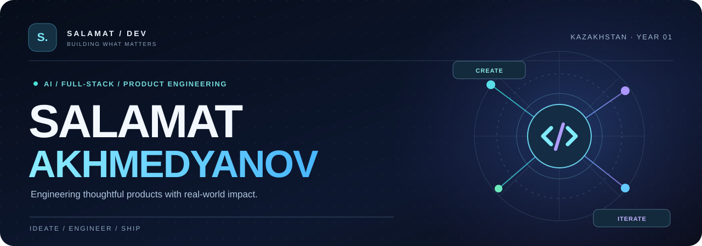
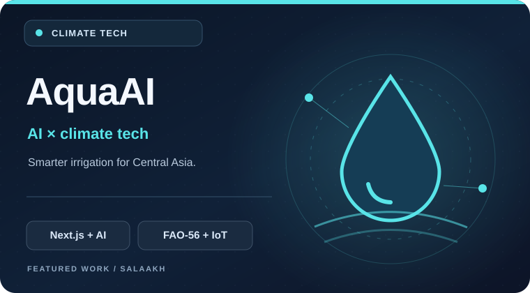
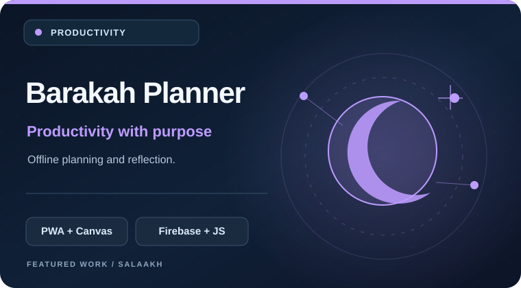
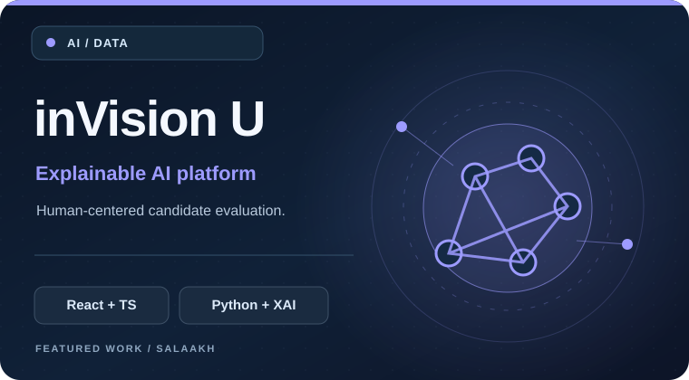
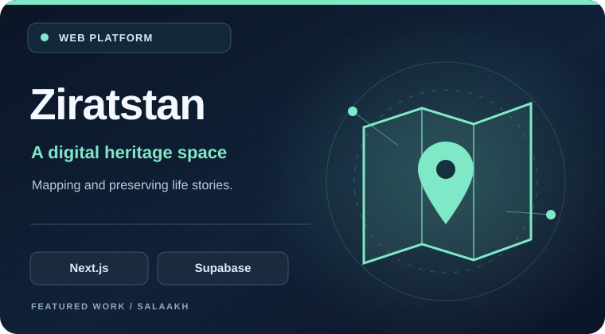

<!--
  SALAAKH / GITHUB PROFILE
  Custom visuals are stored locally in assets/ and do not depend on external image hosts.
  Languages: English / Қазақша / Русский
-->

<p align="center">
  
</p>

<p align="center">
  <a href="./README_KK.md">🇰🇿 Қазақша</a> · <a href="./README.md"><b>🇬🇧 English</b></a> · <a href="./README_RU.md">🇷🇺 Русский</a>
</p>

<p align="center">
  <a href="https://github.com/SalaAkh/AquaAI"></a>
  
  
</p>

<h3 align="center">More than code. Products that solve real problems.</h3>

<p align="center">
  I'm <b>Salamat</b> — a developer from Kazakhstan building AI-enabled products, web platforms and tools people can actually use.<br />
  I enjoy turning ambitious ideas into working systems: from the first prototype to a polished experience.<br />
  🎓 First-year student at <a href="https://www.kstu.kz/">Abylkas Saginov Karaganda Technical University</a>.
</p>

<br />

### 01 / ABOUT ME

```typescript
const salamat = {
  location: "Kazakhstan",
  education: "Abylkas Saginov Karaganda Technical University · Year 1",
  focus: ["AI products", "Full-stack engineering", "Product design"],
  building: "AquaAI — smart irrigation for Central Asia",
  approach: "Think deeply. Build deliberately. Ship often."
};
```

- 🌊 Building **AquaAI**, exploring how AI and agricultural science can improve water use.
- 🧩 Working across frontend, backend, integrations, data, and deployment.
- 🚀 Interested in **climate-tech, responsible AI, meaningful digital products**, and practical problem-solving.

### 02 / FEATURED PROJECTS

<table>
  <tr>
    <td width="50%" valign="top">
      <a href="https://github.com/SalaAkh/AquaAI"></a>
      <h3><a href="https://github.com/SalaAkh/AquaAI">🌊 AquaAI</a></h3>
      <p>AI-powered irrigation intelligence for Central Asia: FAO-56 calculations, weather forecasts and actionable recommendations.</p>
      <p><code>Next.js</code> <code>TypeScript</code> <code>Gemini</code> <code>Solana</code></p>
      <a href="https://github.com/SalaAkh/AquaAI">Explore project →</a>
    </td>
    <td width="50%" valign="top">
      <a href="https://github.com/SalaAkh/Islamic-Planner"></a>
      <h3><a href="https://github.com/SalaAkh/Islamic-Planner">🌙 Barakah Planner</a></h3>
      <p>An offline-first productivity and reflection app with planning, a visual canvas and Firebase synchronization.</p>
      <p><code>JavaScript</code> <code>PWA</code> <code>Konva.js</code> <code>Firebase</code></p>
      <a href="https://github.com/SalaAkh/Islamic-Planner">Source code →</a> · <a href="https://islamic-planer.web.app">Live app ↗</a>
    </td>
  </tr>
  <tr>
    <td width="50%" valign="top">
      <a href="https://github.com/SalaAkh/hahathon-5.0"></a>
      <h3><a href="https://github.com/SalaAkh/hahathon-5.0">🧠 inVision U</a></h3>
      <p>A hackathon project exploring explainable AI, multimodal candidate evaluation and human-in-the-loop review.</p>
      <p><code>React</code> <code>TypeScript</code> <code>FastAPI</code> <code>SHAP</code></p>
      <a href="https://github.com/SalaAkh/hahathon-5.0">Source code →</a> · <a href="https://hahathon-5-0.vercel.app/">Live demo ↗</a>
    </td>
    <td width="50%" valign="top">
      <a href="https://github.com/SalaAkh/ziratstan-app"></a>
      <h3><a href="https://github.com/SalaAkh/ziratstan-app">🗺️ Ziratstan</a></h3>
      <p>A digital heritage platform combining interactive maps, biographical profiles and collaborative memory preservation.</p>
      <p><code>Next.js</code> <code>JavaScript</code> <code>Supabase</code> <code>Firebase</code></p>
      <a href="https://github.com/SalaAkh/ziratstan-app">Source code →</a> · <a href="https://ziratstan-app.web.app/index.html">Live app ↗</a>
    </td>
  </tr>
</table>

<sub>Also worth exploring: <a href="https://github.com/SalaAkh/diplom">Multilingual Self-Discovery System</a> — an interactive, browser-based graduation project supporting Kazakh, Russian and English.</sub>

<br />

### 03 / MY TOOLBOX

<p align="center">
  
</p>

<p align="center"><code>TypeScript</code> · <code>Python</code> · <code>React / Next.js</code> · <code>FastAPI</code> · <code>Firebase</code> · <code>Supabase / PostgreSQL</code> · <code>Docker</code></p>

### 04 / GITHUB ACTIVITY

<p align="center">
  
</p>

<sub>Activity is loaded from a third-party GitHub graph service and may be temporarily unavailable. Public contributions are only one part of the work.</sub>

### 05 / LET'S BUILD SOMETHING VALUABLE

<p align="center">
  <b>Useful ideas deserve thoughtful engineering.</b><br />
  Explore the projects, open an issue, or start a conversation around something we could build together.
</p>

<p align="center">
  <a href="https://github.com/SalaAkh?tab=repositories"></a>
  <a href="https://github.com/SalaAkh/AquaAI"></a>
</p>

<p align="center"><sub>Designed with intention · Built in Kazakhstan · <a href="./README_KK.md">Қазақша</a> · <a href="./README_RU.md">Русский</a></sub></p>