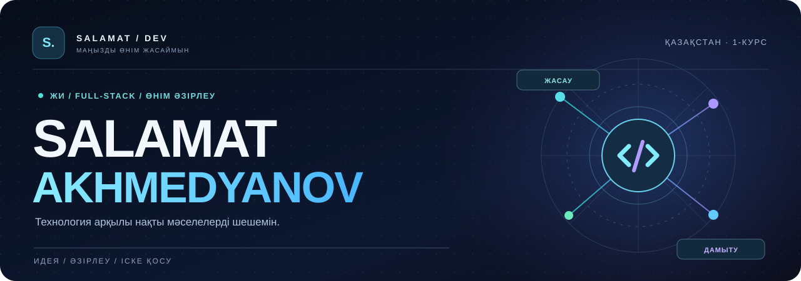
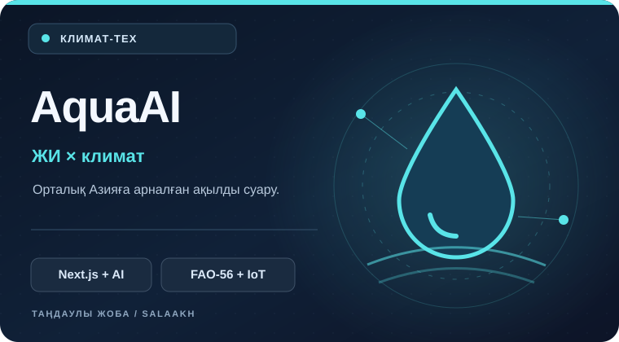
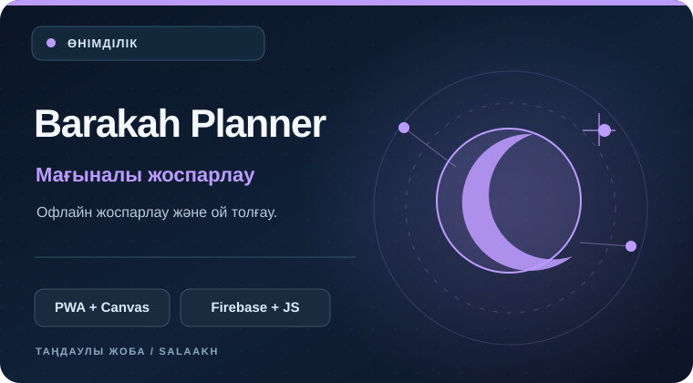
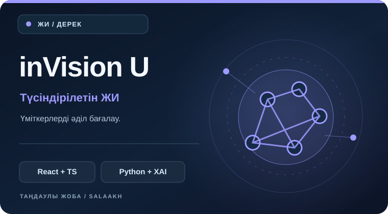
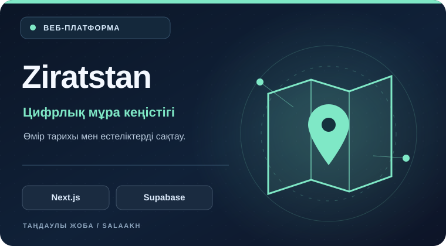

<!-- Қазақша нұсқа. Ағылшынша профиль: ./README.md -->
<p align="center">
  
</p>

<p align="center">
  <a href="./README_KK.md"><b>🇰🇿 Қазақша</b></a> · <a href="./README.md">🇬🇧 English</a> · <a href="./README_RU.md">🇷🇺 Русский</a>
</p>

<p align="center">
  <a href="https://github.com/SalaAkh/AquaAI"></a>
  
  
</p>

<h3 align="center">Жай ғана код емес. Нақты мәселелерді шешетін өнімдер.</h3>

<p align="center">
  Сәлем! Мен <b>Саламатпын</b> — Қазақстаннан шыққан әзірлеушімін. Жасанды интеллектке негізделген өнімдер, веб-платформалар және күнделікті өмірде қолданылатын цифрлық құралдар жасаймын.<br />
  🎓 <a href="https://www.kstu.kz/?lang=kz">Әбілқас Сағынов атындағы Қарағанды техникалық университетінің</a> <b>1-курс</b> студентімін.
</p>

<br />

### 01 / МЕН ТУРАЛЫ

```typescript
const salamat = {
  location: "Қазақстан",
  education: "Әбілқас Сағынов атындағы ҚарТУ · 1-курс",
  focus: ["ЖИ өнімдері", "Full-stack", "Өнімді әзірлеу"],
  building: "AquaAI — Орталық Азияға арналған ақылды суару",
  approach: "Ойлан. Жаса. Іске қос. Жетілдір."
};
```

- 🌊 **AquaAI:** жасанды интеллект пен агрономиялық есептеулерді біріктіріп, су ресурстарын тиімді пайдалануға көмектесетін жүйе әзірлеп жүрмін.
- 🧩 Frontend, backend, API интеграциялары, дерекқор және орналастыру сияқты толық әзірлеу кезеңдерімен жұмыс істеймін.
- 🚀 **Climate-tech, жауапты ЖИ және қоғамға пайдалы цифрлық өнімдер** қызықтырады.

### 02 / ТАҢДАУЛЫ ЖОБАЛАР

<table>
  <tr>
    <td width="50%" valign="top">
      <a href="https://github.com/SalaAkh/AquaAI"></a>
      <h3><a href="https://github.com/SalaAkh/AquaAI">🌊 AquaAI</a></h3>
      <p>Орталық Азияға арналған ақылды суару платформасы: FAO-56 есептеулері, ауа райы болжамы және фермерлерге арналған нақты ұсыныстар.</p>
      <p><code>Next.js</code> <code>TypeScript</code> <code>Gemini</code> <code>Solana</code></p>
      <a href="https://github.com/SalaAkh/AquaAI">Кодты қарау →</a>
    </td>
    <td width="50%" valign="top">
      <a href="https://github.com/SalaAkh/Islamic-Planner"></a>
      <h3><a href="https://github.com/SalaAkh/Islamic-Planner">🌙 Barakah Planner</a></h3>
      <p>Рухани тәжірибе мен күнделікті істерді жоспарлауға арналған қосымша: офлайн жұмыс, визуалды тақта және Firebase синхрондауы.</p>
      <p><code>JavaScript</code> <code>PWA</code> <code>Konva.js</code> <code>Firebase</code></p>
      <a href="https://github.com/SalaAkh/Islamic-Planner">Код →</a> · <a href="https://islamic-planer.web.app">Қосымша →</a>
    </td>
  </tr>
  <tr>
    <td width="50%" valign="top">
      <a href="https://github.com/SalaAkh/hahathon-5.0"></a>
      <h3><a href="https://github.com/SalaAkh/hahathon-5.0">🧠 inVision U</a></h3>
      <p>Хакатон жобасы: үміткерлерді түсіндірілетін ЖИ арқылы бағалау, бірнеше дерек түрін талдау және шешімді адамның бақылауымен қабылдау.</p>
      <p><code>React</code> <code>TypeScript</code> <code>FastAPI</code> <code>SHAP</code></p>
      <a href="https://github.com/SalaAkh/hahathon-5.0">Код →</a> · <a href="https://hahathon-5-0.vercel.app/">Демо →</a>
    </td>
    <td width="50%" valign="top">
      <a href="https://github.com/SalaAkh/ziratstan-app"></a>
      <h3><a href="https://github.com/SalaAkh/ziratstan-app">🗺️ Ziratstan</a></h3>
      <p>Интерактивті карталар, өмірбаяндар және отбасылық естеліктерді сақтауға арналған цифрлық мұра платформасы.</p>
      <p><code>Next.js</code> <code>JavaScript</code> <code>Supabase</code> <code>Firebase</code></p>
      <a href="https://github.com/SalaAkh/ziratstan-app">Код →</a> · <a href="https://ziratstan-app.web.app/index.html">Сайт →</a>
    </td>
  </tr>
</table>

<sub>Басқа жоба: <a href="https://github.com/SalaAkh/diplom">«Өзін-өзі тану жүйесі»</a> — қазақша, орысша және ағылшынша жұмыс істейтін интерактивті дипломдық жоба.</sub>

<br />

### 03 / ТЕХНОЛОГИЯЛАР

<p align="center"></p>
<p align="center"><code>TypeScript</code> · <code>Python</code> · <code>React / Next.js</code> · <code>FastAPI</code> · <code>Firebase</code> · <code>Supabase / PostgreSQL</code> · <code>Docker</code></p>

### 04 / GITHUB БЕЛСЕНДІЛІГІ

<p align="center"></p>
<sub>График сыртқы қызмет арқылы жүктеледі және кейде қолжетімсіз болуы мүмкін. Мұнда тек ашық белсенділік көрсетіледі.</sub>

### 05 / БІРГЕ ПАЙДАЛЫ ӨНІМ ЖАСАЙЫҚ

<p align="center">Жақсы идеяға сапалы іске асыру қажет. Жобаларымды қарап шығыңыз немесе бірге жұмыс істеуге болатын идеямен бөлісіңіз.</p>
<p align="center">
  <a href="https://github.com/SalaAkh?tab=repositories"></a>
  <a href="https://github.com/SalaAkh/AquaAI"></a>
</p>
<p align="center"><sub>Қазақстанда жасалған · <a href="./README.md">English</a> · <a href="./README_RU.md">Русский</a></sub></p>
