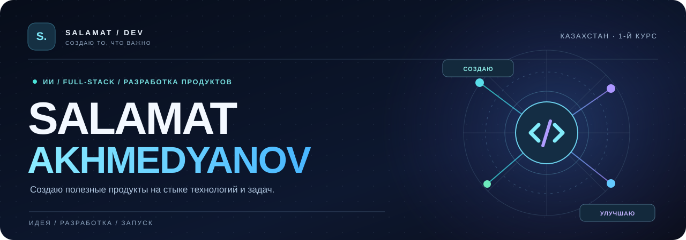
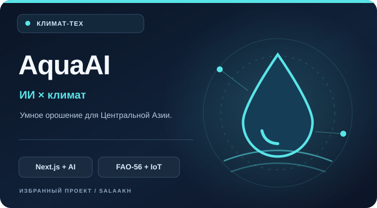
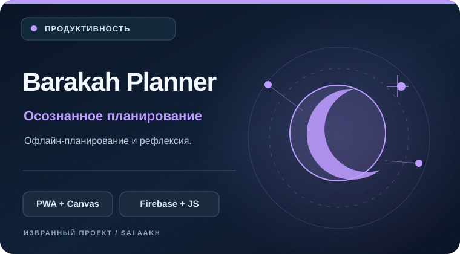
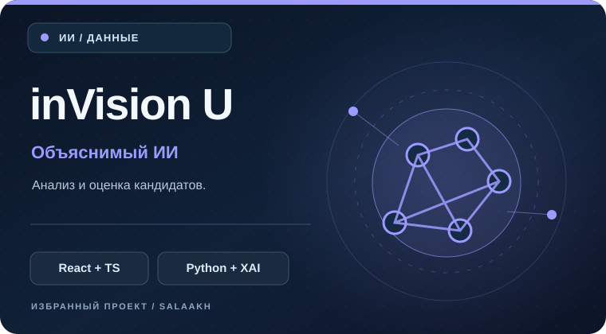
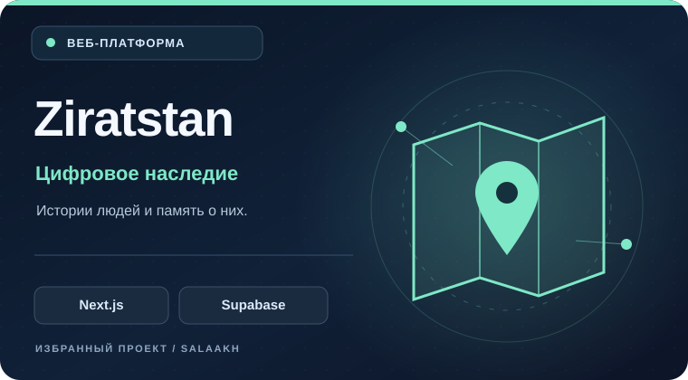

<!-- Русская версия GitHub-профиля. Основной README: ./README.md -->

<p align="center"></p>

<p align="center"><a href="./README_KK.md">🇰🇿 Қазақша</a> · <a href="./README.md">🇬🇧 English</a> · <a href="./README_RU.md"><b>🇷🇺 Русский</b></a></p>

<p align="center">
  <a href="https://github.com/SalaAkh/AquaAI"></a>
  
</p>

<h3 align="center">Не просто код. Продукты, которые решают настоящие задачи.</h3>

<p align="center">Привет! Я <b>Саламат</b>, разработчик из Казахстана. Создаю AI-продукты, веб-платформы и удобные инструменты — от идеи и архитектуры до работающего приложения.<br />🎓 Учусь на 1-м курсе <a href="https://www.kstu.kz/?lang=ru">Карагандинского технического университета имени Абылкаса Сагинова</a>.</p>

<br />

### 01 / ОБО МНЕ

```typescript
const salamat = {
  location: "Казахстан",
  education: "КарТУ имени Абылкаса Сагинова · 1-й курс",
  focus: ["AI-продукты", "Full-stack", "Разработка продуктов"],
  building: "AquaAI — умное орошение для Центральной Азии",
  approach: "Продумывать. Разрабатывать. Запускать. Улучшать."
};
```

- 🌊 **AquaAI:** совмещаю AI, прогноз погоды и агрономические модели для разумного расхода воды.
- 🧩 Разрабатываю frontend, backend, интеграции, базы данных и деплой.
- 🚀 Интересуюсь **climate-tech, ответственным AI** и проектами, которые приносят практическую пользу.

### 02 / ИЗБРАННЫЕ ПРОЕКТЫ

<table>
  <tr>
    <td width="50%" valign="top">
      <a href="https://github.com/SalaAkh/AquaAI"></a>
      <h3><a href="https://github.com/SalaAkh/AquaAI">🌊 AquaAI</a></h3>
      <p>Платформа умного орошения: расчёты по FAO-56, метеопрогнозы и понятные рекомендации для сельского хозяйства.</p>
      <p><code>Next.js</code> <code>TypeScript</code> <code>Gemini</code> <code>Solana</code></p>
      <a href="https://github.com/SalaAkh/AquaAI">Исходный код →</a>
    </td>
    <td width="50%" valign="top">
      <a href="https://github.com/SalaAkh/Islamic-Planner"></a>
      <h3><a href="https://github.com/SalaAkh/Islamic-Planner">🌙 Barakah Planner</a></h3>
      <p>Офлайн-планировщик с духовными практиками, визуальной доской и синхронизацией через Firebase.</p>
      <p><code>JavaScript</code> <code>PWA</code> <code>Konva.js</code> <code>Firebase</code></p>
      <a href="https://github.com/SalaAkh/Islamic-Planner">Код →</a> · <a href="https://islamic-planer.web.app">Открыть приложение ↗</a>
    </td>
  </tr>
  <tr>
    <td width="50%" valign="top">
      <a href="https://github.com/SalaAkh/hahathon-5.0"></a>
      <h3><a href="https://github.com/SalaAkh/hahathon-5.0">🧠 inVision U</a></h3>
      <p>Хакатон-проект: объяснимый AI-анализ кандидатов, мультимодальные данные и контроль решений человеком.</p>
      <p><code>React</code> <code>TypeScript</code> <code>FastAPI</code> <code>SHAP</code></p>
      <a href="https://github.com/SalaAkh/hahathon-5.0">Код →</a> · <a href="https://hahathon-5-0.vercel.app/">Демо ↗</a>
    </td>
    <td width="50%" valign="top">
      <a href="https://github.com/SalaAkh/ziratstan-app"></a>
      <h3><a href="https://github.com/SalaAkh/ziratstan-app">🗺️ Ziratstan</a></h3>
      <p>Цифровая платформа памяти: интерактивные карты, биографии и совместное сохранение семейной истории.</p>
      <p><code>Next.js</code> <code>JavaScript</code> <code>Supabase</code> <code>Firebase</code></p>
      <a href="https://github.com/SalaAkh/ziratstan-app">Код →</a> · <a href="https://ziratstan-app.web.app/index.html">Сайт ↗</a>
    </td>
  </tr>
</table>

<sub>Ещё один проект: <a href="https://github.com/SalaAkh/diplom">«Система самопознания»</a> — интерактивная дипломная работа на казахском, русском и английском языках.</sub>

<br />

### 03 / ТЕХНОЛОГИИ

<p align="center"></p>

<p align="center"><code>TypeScript</code> · <code>Python</code> · <code>React / Next.js</code> · <code>FastAPI</code> · <code>Firebase</code> · <code>Supabase / PostgreSQL</code> · <code>Docker</code></p>

### 04 / АКТИВНОСТЬ НА GITHUB

<p align="center"></p>

<sub>График загружается со стороннего сервиса и иногда может быть недоступен. Он учитывает публичную активность, а не всю проделанную работу.</sub>

### 05 / ДАВАЙ СОЗДАВАТЬ ПОЛЕЗНЫЕ ПРОЕКТЫ

<p align="center">Нравятся проекты на стыке технологий и реальных задач. Посмотри репозитории и напиши, если есть идея, которую стоит воплотить.</p>

<p align="center">
  <a href="https://github.com/SalaAkh?tab=repositories"></a>
  <a href="https://github.com/SalaAkh/AquaAI"></a>
</p>

<p align="center"><sub>Создано с вниманием к деталям · Казахстан · <a href="./README_KK.md">Қазақша</a> · <a href="./README.md">English</a></sub></p>